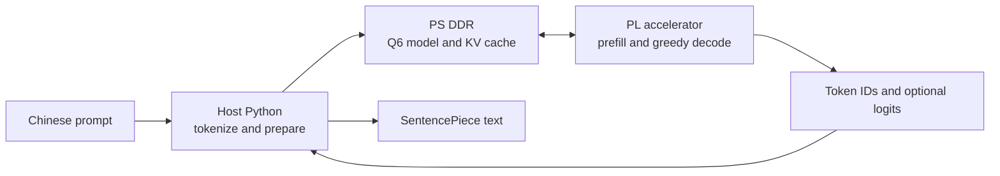

# TinyLLM, running on a PYNQ-Z2

English | [简体中文](README.zh-CN.md)


This project runs a small, Q6-quantized Chinese story model on the PYNQ-Z2. The
ARM prepares the request; programmable logic (PL) takes over prompt prefill and
the complete autoregressive decode loop. The result is a compact, inspectable
FPGA inference project with a measured end-to-end generation rate above 200
tokens per second.

The repository includes the model's Q6W deployment weights, their manifests,
the SentencePiece tokenizer, FP32 training checkpoints, and Q6W-aware training
and evaluation code. The original training corpus is not included.

## The result

### 203.66 generated tokens/s

Measured on a PYNQ-Z2 using a 20-token prompt and 128 generated tokens. This is
the median of five board runs: **0.62850 seconds per request**. Every run matched
the Q6 PyTorch reference token-for-token and matched all 128 per-step logit
argmaxes.

| Same request: 20 prompt tokens + 128 generated tokens | Rate | Validation |
| --- | ---: | --- |
| Autonomous PL, W1/W3 feed-forward projections in parallel | **203.66 tok/s** | 5/5 runs exact; 128/128 argmaxes |
| Tuned PS-only reference | 27.98 tok/s | Exact token IDs and argmaxes |

For this model and request, the PL design is about **7.3x** faster than the tuned
PS-only reference. Host tokenization, model preparation, SSH transfer, and
one-time overlay loading are excluded. The measured PL run returned logits for
numerical validation. This is a benchmark result for the stated model, board,
and request length, not a general claim about FPGA-versus-CPU performance.

The validated overlay uses a 127 MHz PL/HP clock while PS FCLK stays at 125 MHz.
Vivado 2018.2 routed setup slack was +0.020 ns and hold slack was +0.014 ns, with
no failing endpoints. The optional K/V-parallel variant has passed HLS C
simulation and Vivado timing signoff, but has **not** completed a board benchmark
and is not included in the result above.

## Model and training artifacts

This is a customized TinyLLMStory-zh checkpoint, not the unmodified upstream
weight file. Deployment uses signed-int6 weight-only Q6W, with per-row FP32
scales and FP32 RMSNorm parameters:

| Artifact | Source step | SHA-256 | Use |
| --- | ---: | --- | --- |
| `quantization/artifacts/tinyllamas_zh_story_q6w_qat_lr1e6.bin` | 25,000 | `ddeaa72c5923f2c445a7543cf53dc13dffc674f53f49f822c0653ef6735c4c90` | QAT weights; default for deployment |
| `quantization/artifacts/tinyllamas_zh_story_q6w.bin` | 23,900 | `4edc130ef84cbb4450667a3e74ad5f8403608b3f90247256c006ec3604c7a0bf` | Pre-QAT baseline for A/B comparison |

Each `.bin` has a matching JSON manifest with the 47-tensor layout, shapes,
offsets and row scales. Both binaries are 1,130,816 bytes, about 5.12x smaller
than the FP32 unique-weight payload. `tok4096.model` is included for tokenization.
The FP32 checkpoints in `training/checkpoints/` are for training/reproduction;
the QAT checkpoint is **not** the packed model loaded by the PL runtime.

QAT used row-wise fake Q6 quantization with an identity straight-through
estimator. On the same 50 masked validation batches, the exported Q6 loss moved
from 2.203846 to 2.193370 (about 0.48% lower); matched generation stopping was
similar (EOS/cap 121/7 vs 122/6). This demonstrates quantization-error
compensation on that evaluation, not a general story-quality improvement. See
[the Q6W format and evaluation notes](docs/Q6_QUANTIZATION.md) and
[`training/README.md`](training/README.md). The Chinese TinyStories corpus is
not redistributed; see the [upstream dataset](https://huggingface.co/datasets/adam89/TinyStoriesChinese)
and its license terms.

## Autonomous iteration

GPT-6 Luna autonomously carried out the engineering loop: changing candidate
RTL/HLS, running C simulation and synthesis, implementing and routing Vivado
designs, deploying candidates to the board, and checking golden outputs and
throughput. The user supplied the initial RTL, objective, and operating
constraints; no person manually edited the optimization candidates, operated
Vivado, or conducted the board benchmarks.

The optimization took about **one week of autonomous iteration**, based on the
Vivado/HLS project logs. Later documentation and release work are excluded.

| Milestone | End-to-end board result | What changed |
| --- | ---: | --- |
| First autonomous full-model PL prototype | **8.62 tok/s** | Full 128-token generation on PL; 3-run median 14.856 s, with exact generated IDs and per-step argmaxes |
| Streamed full-model datapath | **190.90 tok/s** | Reworked matrix streaming, II=1 MAC scheduling, and DDR/dataflow behavior; 5-run median 0.67048 s |
| Parallel FFN and faster PL/HP clock | **203.66 tok/s** | W1/W3 execute concurrently on separate memory ports; PL/HP at 127 MHz, PS at 125 MHz; 5-run median 0.62850 s |

All three milestones use the same 20-token prompt and 128-token generation
request. The final result is **23.64x** the first autonomous PL result and 6.7%
above the preceding full-PL design. The first PL version was about 3.25x slower
than the tuned PS-only reference; the final version is 7.3x faster than it.
Slower variants and builds that failed routed timing were rejected rather than
counted as progress. An additional K/V-parallel candidate passed HLS C simulation
and route signoff, but lacks a valid board benchmark and is excluded.

## What runs where



The PL performs embeddings, all transformer layers, attention, KV-cache updates,
final normalization, vocabulary projection, argmax, and stop-token handling. The
model image and KV cache live in PS DDR and are accessed through AXI HP ports;
the full model does not fit in BRAM.

The benchmark model is a five-layer, Llama-style Chinese story model with about
1.45M parameters: dimension 128, four query heads, two KV heads, vocabulary 4096,
and maximum context 512. The measured speed profile runs the two FFN input
projections, W1 and W3, in parallel using separate memory ports.

## Try the benchmark request

The standard test prompt is:

```text
故事开头：从前，有一只叫小白的兔子。
续写：
```

The preparation script builds a fixed request and a PyTorch golden result. A
successful board run checks both generated token IDs and per-step logits against
that golden. The benchmark record looks like this:

```text
prompt tokens:       20
generated tokens:   128
median board time:  0.62850 s  (5 runs)
generation rate:    203.66 tok/s
token IDs:          exact on all runs
logit argmax:       128 / 128 steps
```

## Reproduce it

### Requirements

- Vivado and Vivado HLS 2018.2, with PYNQ-Z2 board files installed.
- PYNQ-Z2 running the PYNQ 2.5 image for the measured runtime.
- Host Python with the dependencies in `requirements-host.txt`.
- The Q6W artifacts and PyTorch reference benchmark are included; no companion
  checkout is needed for the standard flow.

```text
LLM-PYNQ/q6w_gemv/
  quantization/artifacts/
  training/checkpoints/
```

Create a host environment from the project root:

```powershell
python -m venv .venv
.\.venv\Scripts\Activate.ps1
python -m pip install -r requirements-host.txt
```

### Prepare the golden request

```powershell
python scripts\prepare_e2e.py --linear-mode ps `
  --max-new-tokens 128 --min-new-tokens 4 `
  --out-dir build\autonomous_hls\e2e128
python scripts\generate_hls_layout.py `
  --manifest build\autonomous_hls\e2e128\manifest.json `
  --weights build\autonomous_hls\e2e128\model_q6w.bin `
  --model-output build\autonomous_hls\e2e128\autonomous_model.bin `
  --output rtl\autonomous\model_layout.h
python scripts\prepare_hls_testdata.py --package-dir build\autonomous_hls\e2e128
```

### Build the accelerator and overlay

Set `AUTONOMOUS_PYTHON` to the Python executable from the environment above and
adjust the Vivado paths if needed:

```powershell
$env:AUTONOMOUS_HLS_PROJECT = "tinyllm_pynq_par"
$env:AUTONOMOUS_PACKAGE_DIR = (Resolve-Path "build\autonomous_hls\e2e128").Path
$env:AUTONOMOUS_PYTHON = (Get-Command python).Source
$env:AUTONOMOUS_PERFORMANCE_BUILD = "1"
$env:AUTONOMOUS_LEGACY_KV_MIRROR = "1"
$env:AUTONOMOUS_PARALLEL_FFN = "1"
$vivadoHls = "C:\Xilinx\Vivado\2018.2\bin\vivado_hls.bat"
& $vivadoHls -f scripts\build_autonomous_hls.tcl
```

The HLS build runs C simulation, synthesis, and IP export. Then create the
PYNQ-Z2 overlay. The build script publishes a bitstream only after routed setup
and hold signoff pass.

```powershell
$env:AUTONOMOUS_OVERLAY_TAG = "par127"
$env:AUTONOMOUS_PL_MHZ = "125"
$env:AUTONOMOUS_CORE_MHZ = "127"
$env:AUTONOMOUS_MEMORY_FAST_CLOCK = "1"
$env:AUTONOMOUS_PHYS_OPT_DIRECTIVE = "AggressiveExplore"
$vivado = "C:\Xilinx\Vivado\2018.2\bin\vivado.bat"
& $vivado -mode batch -source scripts\build_autonomous_overlay.tcl
```

The overlay is emitted under `build/autonomous_overlay_par127/output/`.

### Run on the board

Set `PYNQ_HOST` to the board's address. The script prompts for its password
unless `PYNQ_PASSWORD` is set in the local shell. Never commit credentials.

```powershell
$env:PYNQ_HOST = "<your-pynq-z2-address>"
python scripts\deploy_autonomous.py `
  --package-dir build\autonomous_hls\e2e128 `
  --overlay-dir build\autonomous_overlay_par127\output `
  --remote-dir /home/xilinx/tinyllm-pynq/par127 `
  --clock-mhz 125 --runs 5 --dump-logits --performance-overlay `
  --legacy-kv-mirror --dual-ffn-w3
```

The overlay is loaded at runtime; this flow does not rewrite the SD boot
partition or require a reboot.

### Experimental K/V parallelism

The source also contains a K/V-parallel experiment. To enable it, add these HLS
settings (the experiment also requires the FFN parallelism and legacy buffer
options shown above):

```powershell
$env:AUTONOMOUS_PRECOMPUTED_ROPE = "1"
$env:AUTONOMOUS_PARALLEL_KV = "1"
```

Deploy it with `--parallel-kv`. Benchmark it independently before comparing or
reporting its throughput; it is not yet board-validated.

## Repository map

| Path | Contents |
| --- | --- |
| `rtl/autonomous/` | Full-model HLS accelerator and C-simulation testbench |
| `rtl/*.sv`, `sim/` | Streaming Q6 GEMV RTL experiments and testbenches |
| `scripts/build_autonomous_*.tcl` | HLS and Vivado overlay build flows |
| `scripts/prepare_*.py` | Golden requests, model layout, and simulation inputs |
| `scripts/deploy_*.py`, `autonomous_board.py` | Board deployment and runtime |
| `quantization/artifacts/` | Q6W baseline/QAT weights and manifests |
| `training/checkpoints/` | FP32 starting point and QAT master checkpoints |
| `training/` | QAT, data preparation, validation, and training source |
| `docs/Q6_QUANTIZATION.md` | Q6W format, hashes, and evaluation results |
| `docs/RTL_REFERENCE.md` | Model topology, tensor shapes, and reference equations |
| `build/` | Generated projects, model images, bitstreams, and reports; Git-ignored |

## License and attribution

This repository's original RTL and source code are licensed under the MIT
License. Most vendored training sources retain their MIT attribution in
`training/LICENSE`;
`training/tokenizer.py` has a separate Meta Llama 2 Community License notice
documented in `training/NOTICE.md` and `training/LLAMA2_LICENSE.txt`. The Q6W weights and trained SentencePiece
model retain the model project's MIT notice in `quantization/LICENSE`. The raw
training corpus is not included and remains subject to its separate dataset
license. The upstream model project is
[ModenCn/tinyllamas-zh](https://github.com/ModenCn/tinyllamas-zh).
