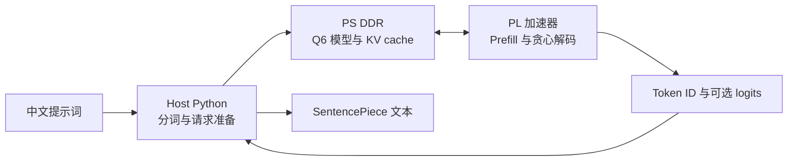

# 在 PYNQ-Z2 上运行 TinyLLM

[English](README.md) | 简体中文


这个项目把一个 Q6 量化的中文故事小模型跑在 PYNQ-Z2 上。ARM 负责准备
请求，PL（可编程逻辑）接管 prompt prefill 和完整的自回归解码循环。目前已
实现并实测超过 **200 tokens/s**，是一套可检查、可复现的 FPGA 推理工程。

仓库包含该模型的 Q6W 部署权重及格式清单、SentencePiece tokenizer、FP32
训练 checkpoint，以及 Q6W 感知训练与评估代码。原始训练语料不在仓库中。

## 实测结果

### 每秒生成 203.66 个 token

测试平台为 PYNQ-Z2，输入 20 个 prompt token，生成 128 个 token。五次板上
运行的中位数为 **每次 0.62850 秒**。五次生成 token ID 均与 Q6 PyTorch
参考实现逐 token 完全一致，每一步的 logits argmax 也全部匹配。

| 相同请求：20 个 prompt token + 生成 128 个 token | 速度 | 验证 |
| --- | ---: | --- |
| PL 自主推理，FFN 的 W1/W3 投影并行 | **203.66 tok/s** | 5/5 次 token 精确匹配；128/128 步 argmax 一致 |
| 优化后的 PS-only 参考实现 | 27.98 tok/s | token ID 与 argmax 均精确匹配 |

对这个模型和请求长度，PL 版本约为优化后 PS-only 速度的 **7.3 倍**。计时
不包含 host tokenizer、模型准备、SSH 文件传输和首次 overlay 加载。板测开启
了完整 logits 返回以做数值校验。这是特定模型、开发板和请求长度下的实测，
不代表 FPGA 对 CPU 的普遍性能结论。

验证通过的 overlay 使用 127 MHz PL/HP 时钟，PS FCLK 保持 125 MHz。Vivado
2018.2 routed setup slack 为 +0.020 ns、hold slack 为 +0.014 ns，且没有失败
端点。代码中还有 K/V 并行实验版本，它通过了 HLS C 仿真和 Vivado 时序签核，
但**尚未完成板测**，因此不计入上面的成绩。

## 模型权重与训练产物

这里使用的是 TinyLLMStory-zh 的定制 checkpoint，不是未经修改的原版权重。
部署格式为 signed-int6 weight-only Q6W，每输出行带 FP32 scale，RMSNorm 参数
仍为 FP32：

| 文件 | 来源 step | SHA-256 | 用途 |
| --- | ---: | --- | --- |
| `quantization/artifacts/tinyllamas_zh_story_q6w_qat_lr1e6.bin` | 25,000 | `ddeaa72c5923f2c445a7543cf53dc13dffc674f53f49f822c0653ef6735c4c90` | QAT 权重，默认部署版本 |
| `quantization/artifacts/tinyllamas_zh_story_q6w.bin` | 23,900 | `4edc130ef84cbb4450667a3e74ad5f8403608b3f90247256c006ec3604c7a0bf` | QAT 前基线，用于 A/B 比较 |

每个 `.bin` 都有配套 JSON 清单，描述47个 tensor 的顺序、shape、偏移和行
scale。两个二进制文件大小均为1,130,816字节，约为 FP32 唯一权重体积的
5.12倍压缩。仓库也包含 `tok4096.model`。`training/checkpoints/` 中的是 FP32
训练 checkpoint；QAT checkpoint 是训练用 master/优化器状态，**不是** PL 要
加载的 packed `.bin`。

QAT 在每次前向中对权重做逐行 Q6 fake quantization，并用 identity STE 反向传播。
相同50个 masked validation batch 上，导出的 Q6 loss 从2.203846降到2.193370
（约0.48%）；生成停止统计相近（EOS/cap 为121/7与122/6）。这说明该评估集
上的量化误差补偿，不代表普遍的故事质量提升。格式、哈希和详细结果见
[Q6W 文档](docs/Q6_QUANTIZATION.md)，训练来源与命令见
[`training/README.md`](training/README.md)。训练语料不随仓库发布；请查看
[上游 TinyStoriesChinese 数据集](https://huggingface.co/datasets/adam89/TinyStoriesChinese)
及其许可。

## 自主迭代记录

GPT-6 Luna 自主完成了工程迭代闭环：修改候选 RTL/HLS、运行 C 仿真与综合、
执行 Vivado 实现与布线、部署候选版本到开发板，并核对 golden 输出和吞吐率。
用户提供了初版 RTL、优化目标和运行约束；后续候选代码没有人工手动修改，
Vivado 没有人工操作，板测也由 Agent 自动执行。

从初版 RTL 到当前结果，GPT-6 Luna 自主迭代约 **一周**，依据 Vivado/HLS
工程日志估算；后续文档整理和开源发布不计入其中。

| 里程碑 | 端到端板测速度 | 主要变化 |
| --- | ---: | --- |
| 首个自主全模型 PL 原型 | **8.62 tok/s** | PL 完成 128-token 自回归生成；3 次运行中位数 14.856 秒，生成 token 和每步 argmax 精确匹配 |
| 流式全模型数据通路 | **190.90 tok/s** | 重做矩阵流式处理、II=1 MAC 调度及 DDR/dataflow；5 次运行中位数 0.67048 秒 |
| FFN 并行与更快的 PL/HP 时钟 | **203.66 tok/s** | W1/W3 使用独立内存端口并行执行；PL/HP 127 MHz、PS 125 MHz；5 次运行中位数 0.62850 秒 |

三个里程碑使用相同的 20-token prompt 和 128-token 生成请求。最终速度是首个
自主 PL 版本的 **23.64 倍**，比上一个完整 PL 版本再快 6.7%。首个 PL 版本
约比优化后的 PS-only 慢 3.25 倍；最终版本则快 7.3 倍。较慢的候选和未通过
route 时序签核的构建均未算作进步。另一个 K/V 并行候选虽通过 HLS C 仿真和
Vivado route 签核，但没有有效板测，因此不计入速度成绩。

## 推理流程



PL 执行 embedding、全部 Transformer 层、attention、KV cache 更新、最终
归一化、词表投影、argmax 和 stop-token 判断。模型映像和 KV cache 位于 PS
DDR，经 AXI HP 端口访问；整个模型并没有塞进 BRAM。

基准模型是一个 Llama 风格中文故事模型：5 层、约 145 万参数、维度 128、
4 个 query head、2 个 KV head、词表 4096，最大上下文长度 512。当前实测配置
通过独立内存端口并行执行 FFN 输入投影 W1 与 W3。

## 示例：准备并验证一次生成

默认测试提示词：

```text
故事开头：从前，有一只叫小白的兔子。
续写：
```

准备脚本会生成固定请求和 PyTorch golden。板上运行后会校验生成 token ID 和
每步 logits。已验证结果记录如下：

```text
prompt token 数：      20
生成 token 数：       128
板测中位数：          0.62850 秒（5 次）
生成速度：            203.66 tok/s
Token ID：            所有运行均精确匹配
Logit argmax：        128 / 128 步匹配
```

## 复现步骤

### 环境要求

- Vivado 和 Vivado HLS 2018.2，并安装 PYNQ-Z2 板卡文件。
- PYNQ-Z2 运行 PYNQ 2.5 镜像，以复现当前实测运行环境。
- Host Python 环境及 `requirements-host.txt` 中的依赖。
- Q6W 权重和 PyTorch 参考 benchmark 已包含在本仓库，标准流程无需另行克隆模型仓库。

```text
LLM-PYNQ/q6w_gemv/
  quantization/artifacts/
  training/checkpoints/
```

在工程目录下创建 Python 环境：

```powershell
python -m venv .venv
.\.venv\Scripts\Activate.ps1
python -m pip install -r requirements-host.txt
```

### 准备 golden 请求

```powershell
python scripts\prepare_e2e.py --linear-mode ps `
  --max-new-tokens 128 --min-new-tokens 4 `
  --out-dir build\autonomous_hls\e2e128
python scripts\generate_hls_layout.py `
  --manifest build\autonomous_hls\e2e128\manifest.json `
  --weights build\autonomous_hls\e2e128\model_q6w.bin `
  --model-output build\autonomous_hls\e2e128\autonomous_model.bin `
  --output rtl\autonomous\model_layout.h
python scripts\prepare_hls_testdata.py --package-dir build\autonomous_hls\e2e128
```

### 构建加速器与 overlay

将 `AUTONOMOUS_PYTHON` 指向上面环境里的 Python；按实际安装位置修改 Vivado
路径：

```powershell
$env:AUTONOMOUS_HLS_PROJECT = "tinyllm_pynq_par"
$env:AUTONOMOUS_PACKAGE_DIR = (Resolve-Path "build\autonomous_hls\e2e128").Path
$env:AUTONOMOUS_PYTHON = (Get-Command python).Source
$env:AUTONOMOUS_PERFORMANCE_BUILD = "1"
$env:AUTONOMOUS_LEGACY_KV_MIRROR = "1"
$env:AUTONOMOUS_PARALLEL_FFN = "1"
$vivadoHls = "C:\Xilinx\Vivado\2018.2\bin\vivado_hls.bat"
& $vivadoHls -f scripts\build_autonomous_hls.tcl
```

HLS 流程会执行 C 仿真、综合和 IP 导出。随后构建 PYNQ-Z2 overlay；只有
routed setup/hold 时序签核通过后，脚本才会发布 bitstream：

```powershell
$env:AUTONOMOUS_OVERLAY_TAG = "par127"
$env:AUTONOMOUS_PL_MHZ = "125"
$env:AUTONOMOUS_CORE_MHZ = "127"
$env:AUTONOMOUS_MEMORY_FAST_CLOCK = "1"
$env:AUTONOMOUS_PHYS_OPT_DIRECTIVE = "AggressiveExplore"
$vivado = "C:\Xilinx\Vivado\2018.2\bin\vivado.bat"
& $vivado -mode batch -source scripts\build_autonomous_overlay.tcl
```

Overlay 输出位于 `build/autonomous_overlay_par127/output/`。

### 部署到开发板

将 `PYNQ_HOST` 设置为板卡地址。脚本会交互式询问密码，除非在本地 shell 中
设置了 `PYNQ_PASSWORD`。不要把凭据提交到 Git。

```powershell
$env:PYNQ_HOST = "<your-pynq-z2-address>"
python scripts\deploy_autonomous.py `
  --package-dir build\autonomous_hls\e2e128 `
  --overlay-dir build\autonomous_overlay_par127\output `
  --remote-dir /home/xilinx/tinyllm-pynq/par127 `
  --clock-mhz 125 --runs 5 --dump-logits --performance-overlay `
  --legacy-kv-mirror --dual-ffn-w3
```

overlay 在运行时加载；此流程不会改写 SD 卡启动分区，也不需要重启开发板。

### K/V 并行实验版

源码中还包含 K/V 投影并行实验版。构建 HLS IP 时增加以下设置（还需要上文
的 FFN 并行和 legacy buffer 配置）：

```powershell
$env:AUTONOMOUS_PRECOMPUTED_ROPE = "1"
$env:AUTONOMOUS_PARALLEL_KV = "1"
```

部署时加 `--parallel-kv`。在单独完成板测前，不要将它的速度与已验证结果混报。

## 目录速览

| 路径 | 内容 |
| --- | --- |
| `rtl/autonomous/` | 全模型 HLS 加速器与 C 仿真 testbench |
| `rtl/*.sv`, `sim/` | Q6 GEMV 流水 RTL 实验与 testbench |
| `scripts/build_autonomous_*.tcl` | HLS 和 Vivado overlay 构建流程 |
| `scripts/prepare_*.py` | Golden 请求、模型布局和仿真输入准备 |
| `scripts/deploy_*.py`, `autonomous_board.py` | 开发板部署与运行 |
| `quantization/artifacts/` | Q6W 基线/QAT 权重与格式清单 |
| `training/checkpoints/` | FP32 起点与 QAT master checkpoint |
| `training/` | QAT、数据准备、验证和训练代码 |
| `docs/Q6_QUANTIZATION.md` | Q6W 格式、哈希和量化评估结果 |
| `docs/RTL_REFERENCE.md` | 模型拓扑、tensor shape 和参考公式 |
| `build/` | 自动生成的工程、模型映像、bitstream 和报告；Git 忽略 |

## 许可证与模型来源

本仓库自有 RTL 和源码使用 MIT License。大部分 vendored 训练源码保留
`training/LICENSE` 中的 MIT 署名；`training/tokenizer.py` 另受 Meta Llama 2
Community License 约束，见 `training/NOTICE.md` 与 `training/LLAMA2_LICENSE.txt`。Q6W 权重和训练得到的
SentencePiece 模型保留 `quantization/LICENSE` 中的模型项目 MIT 声明。原始训练
语料不包含在仓库中，仍受其单独数据许可约束。上游模型项目为
[ModenCn/tinyllamas-zh](https://github.com/ModenCn/tinyllamas-zh)。
