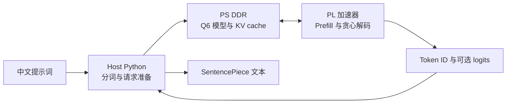

# 在 PYNQ-Z2 上运行 TinyLLM

[English](README.md) | 简体中文


这个项目把一个 Q6 量化的中文故事小模型跑在 PYNQ-Z2 上。ARM 负责准备
请求，PL（可编程逻辑）接管 prompt prefill 和完整的自回归解码循环。目前已
实现并实测超过 **200 tokens/s**，是一套可检查、可复现的 FPGA 推理工程。

仓库不包含模型权重、checkpoint、tokenizer 或训练数据。模型文件和使用条款
请查看[配套模型仓库](https://github.com/ModenCn/tinyllamas-zh)。

## 实测结果

### 每秒生成 203.66 个 token

测试平台为 PYNQ-Z2，输入 20 个 prompt token，生成 128 个 token。五次板上
运行的中位数为 **每次 0.62850 秒**。五次生成 token ID 均与 Q6 PyTorch
参考实现逐 token 完全一致，每一步的 logits argmax 也全部匹配。

| 相同请求：20 个 prompt token + 生成 128 个 token | 速度 | 验证 |
| --- | ---: | --- |
| PL 自主推理，FFN 的 W1/W3 投影并行 | **203.66 tok/s** | 5/5 次 token 精确匹配；128/128 步 argmax 一致 |
| 优化后的 PS-only 参考实现 | 27.98 tok/s | token ID 与 argmax 均精确匹配 |

对这个模型和请求长度，PL 版本约为优化后 PS-only 速度的 **7.3 倍**。计时
不包含 host tokenizer、模型准备、SSH 文件传输和首次 overlay 加载。板测开启
了完整 logits 返回以做数值校验。这是特定模型、开发板和请求长度下的实测，
不代表 FPGA 对 CPU 的普遍性能结论。

验证通过的 overlay 使用 127 MHz PL/HP 时钟，PS FCLK 保持 125 MHz。Vivado
2018.2 routed setup slack 为 +0.020 ns、hold slack 为 +0.014 ns，且没有失败
端点。代码中还有 K/V 并行实验版本，它通过了 HLS C 仿真和 Vivado 时序签核，
但**尚未完成板测**，因此不计入上面的成绩。

## 推理流程



PL 执行 embedding、全部 Transformer 层、attention、KV cache 更新、最终
归一化、词表投影、argmax 和 stop-token 判断。模型映像和 KV cache 位于 PS
DDR，经 AXI HP 端口访问；整个模型并没有塞进 BRAM。

基准模型是一个 Llama 风格中文故事模型：5 层、约 145 万参数、维度 128、
4 个 query head、2 个 KV head、词表 4096，最大上下文长度 512。当前实测配置
通过独立内存端口并行执行 FFN 输入投影 W1 与 W3。

## 示例：准备并验证一次生成

默认测试提示词：

```text
故事开头：从前，有一只叫小白的兔子。
续写：
```

准备脚本会生成固定请求和 PyTorch golden。板上运行后会校验生成 token ID 和
每步 logits。已验证结果记录如下：

```text
prompt token 数：      20
生成 token 数：       128
板测中位数：          0.62850 秒（5 次）
生成速度：            203.66 tok/s
Token ID：            所有运行均精确匹配
Logit argmax：        128 / 128 步匹配
```

## 复现步骤

### 环境要求

- Vivado 和 Vivado HLS 2018.2，并安装 PYNQ-Z2 板卡文件。
- PYNQ-Z2 运行 PYNQ 2.5 镜像，以复现当前实测运行环境。
- Host Python 环境及 `requirements-host.txt` 中的依赖。
- 配套的 [ModenCn/tinyllamas-zh](https://github.com/ModenCn/tinyllamas-zh)
  仓库，提供 Q6W 模型文件和 PyTorch 参考实现。两个仓库可并排放置：

```text
workspace/
  LLM-PYNQ/q6w_gemv/
  TinyLLMStory-zh/
```

在工程目录下创建 Python 环境：

```powershell
python -m venv .venv
.\.venv\Scripts\Activate.ps1
python -m pip install -r requirements-host.txt
```

### 准备 golden 请求

```powershell
$modelRepo = (Resolve-Path "..\..\TinyLLMStory-zh").Path
python scripts\prepare_e2e.py --model-repo $modelRepo --linear-mode ps `
  --max-new-tokens 128 --min-new-tokens 4 `
  --out-dir build\autonomous_hls\e2e128
python scripts\generate_hls_layout.py `
  --manifest build\autonomous_hls\e2e128\manifest.json `
  --weights build\autonomous_hls\e2e128\model_q6w.bin `
  --model-output build\autonomous_hls\e2e128\autonomous_model.bin `
  --output rtl\autonomous\model_layout.h
python scripts\prepare_hls_testdata.py --package-dir build\autonomous_hls\e2e128
```

### 构建加速器与 overlay

将 `AUTONOMOUS_PYTHON` 指向上面环境里的 Python；按实际安装位置修改 Vivado
路径：

```powershell
$env:AUTONOMOUS_HLS_PROJECT = "tinyllm_pynq_par"
$env:AUTONOMOUS_PACKAGE_DIR = (Resolve-Path "build\autonomous_hls\e2e128").Path
$env:AUTONOMOUS_PYTHON = (Get-Command python).Source
$env:AUTONOMOUS_PERFORMANCE_BUILD = "1"
$env:AUTONOMOUS_LEGACY_KV_MIRROR = "1"
$env:AUTONOMOUS_PARALLEL_FFN = "1"
$vivadoHls = "C:\Xilinx\Vivado\2018.2\bin\vivado_hls.bat"
& $vivadoHls -f scripts\build_autonomous_hls.tcl
```

HLS 流程会执行 C 仿真、综合和 IP 导出。随后构建 PYNQ-Z2 overlay；只有
routed setup/hold 时序签核通过后，脚本才会发布 bitstream：

```powershell
$env:AUTONOMOUS_OVERLAY_TAG = "par127"
$env:AUTONOMOUS_PL_MHZ = "125"
$env:AUTONOMOUS_CORE_MHZ = "127"
$env:AUTONOMOUS_MEMORY_FAST_CLOCK = "1"
$env:AUTONOMOUS_PHYS_OPT_DIRECTIVE = "AggressiveExplore"
$vivado = "C:\Xilinx\Vivado\2018.2\bin\vivado.bat"
& $vivado -mode batch -source scripts\build_autonomous_overlay.tcl
```

Overlay 输出位于 `build/autonomous_overlay_par127/output/`。

### 部署到开发板

将 `PYNQ_HOST` 设置为板卡地址。脚本会交互式询问密码，除非在本地 shell 中
设置了 `PYNQ_PASSWORD`。不要把凭据提交到 Git。

```powershell
$env:PYNQ_HOST = "<your-pynq-z2-address>"
python scripts\deploy_autonomous.py `
  --package-dir build\autonomous_hls\e2e128 `
  --overlay-dir build\autonomous_overlay_par127\output `
  --remote-dir /home/xilinx/tinyllm-pynq/par127 `
  --clock-mhz 125 --runs 5 --dump-logits --performance-overlay `
  --legacy-kv-mirror --dual-ffn-w3
```

overlay 在运行时加载；此流程不会改写 SD 卡启动分区，也不需要重启开发板。

### K/V 并行实验版

源码中还包含 K/V 投影并行实验版。构建 HLS IP 时增加以下设置（还需要上文
的 FFN 并行和 legacy buffer 配置）：

```powershell
$env:AUTONOMOUS_PRECOMPUTED_ROPE = "1"
$env:AUTONOMOUS_PARALLEL_KV = "1"
```

部署时加 `--parallel-kv`。在单独完成板测前，不要将它的速度与已验证结果混报。

## 目录速览

| 路径 | 内容 |
| --- | --- |
| `rtl/autonomous/` | 全模型 HLS 加速器与 C 仿真 testbench |
| `rtl/*.sv`, `sim/` | Q6 GEMV 流水 RTL 实验与 testbench |
| `scripts/build_autonomous_*.tcl` | HLS 和 Vivado overlay 构建流程 |
| `scripts/prepare_*.py` | Golden 请求、模型布局和仿真输入准备 |
| `scripts/deploy_*.py`, `autonomous_board.py` | 开发板部署与运行 |
| `build/` | 自动生成的工程、模型映像、bitstream 和报告；Git 忽略 |

## 许可证与模型来源

本仓库 RTL 与源码使用 MIT License。模型、checkpoint、tokenizer 和训练数据
不包含在本仓库中，仍受各自条款约束。参考模型实现和 Q6W 格式来自
[ModenCn/tinyllamas-zh](https://github.com/ModenCn/tinyllamas-zh)；模型及数据
来源和许可请以该项目说明为准。
